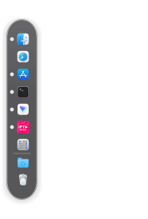

# BrisaDock para Linux (`v0.37`)

**BrisaDock** es un lanzador y barra de tareas independiente para Linux (KDE Plasma / X11 y Wayland) diseñado con fidelidad visual y funcional al **Dock de macOS** (Sonoma / Sequoia / Tahoe).



## Características Principales

- **Estética de Cristal (Glassmorphism)**:
  - Desenfoque nativo detrás de la superficie en KWin (`_KDE_NET_WM_BLUR_BEHIND_REGION`), doble borde especular, modo claro/oscuro y color/opacidad personalizables.
  - Globo de etiqueta (`Callout`) unificado con punta triangular e insignias rojas (`#ff3b30`) de notificación/atención.
  - Iconos vectoriales integrados estilo macOS: **Archivos (Finder)** unificado con el gestor de archivos del sistema, **Navegador (Safari)**, **Aplicaciones (Launchpad)**, **Descargas** y **Papelera de cristal esmerilado** (vacía y llena).
- **7 Zonas Canónicas del Dock**:
  - `Archivos` · `Navegador` · `Aplicaciones ancladas y abiertas` · `Lanzador de Aplicaciones` · `Separador` · `Aplicaciones recientes` · `Separador` · `Carpetas / Pilas (Stacks)` · `Ventanas minimizadas` · `Papelera`.
- **Interacción macOS Completa**:
  - **Ampliación parabólica suave** al pasar el cursor y **redimensionado en vivo** arrastrando el separador vertical (`16 px – 72 px`).
  - **Carpetas y Pilas (`Stacks`)**: vistas en **Abanico (`Fan`)**, **Rejilla (`Grid`)**, **Lista (`List`)** o **Automático**, con soporte para arrastrar archivos dentro (`Mover a` / `Copiar a` con `Ctrl`) y apertura automática (`Spring-loading` a los `650 ms`).
  - **Arrastrar documentos sobre aplicaciones** para abrirlos directamente (`Abrir con…`).
  - **Papelera interactiva**: arrastrar archivos para enviarlos a la papelera, contador de elementos y menú contextual (`Abrir Papelera`, `Vaciar Papelera…`).
  - **Efectos de minimización**: escala y **lámina (`Genie / Sheet effect`)**, más vistas previas en vivo por `XComposite`.
  - **Ocultar aplicaciones**: `Ocultar aplicación`, `Ocultar otras aplicaciones` y `Mostrar aplicaciones ocultas` con iconos atenuados al 50%.
  - **Soporte Híbrido X11 + Wayland (KWin)**: integración completa EWMH en X11 y puente D-Bus `org.kde.KWin` `/Scripting` en sesiones Wayland.
  - **Accesibilidad por teclado**: `Ctrl+Alt+D` o `brisadock --keyboard`.

---

## Instalación

### Opción 1: Paquete `.deb` (Ubuntu / Linux Mint / Debian / KDE Neon)

Descarga `brisadock_0.37_all.deb` desde la sección **Releases** o genéralo localmente:

```bash
./empaquetar-deb.sh
sudo apt install ./dist/brisadock_0.37_all.deb
```

Una vez instalado, puedes iniciarlo desde tu menú de aplicaciones (**BrisaDock**) o ejecutando:

```bash
brisadock
```

### Opción 2: Ejecución desde el código fuente

```bash
git clone https://github.com/Linesi1989/brisadock-linux.git
cd brisadock-linux
python3 -m venv .venv
.venv/bin/pip install -r requirements.txt
./iniciar-brisadock.sh
```

---

## Empaquetado para Tiendas de Linux

En la carpeta [`empaquetado/`](empaquetado/) se incluyen los manifiestos listos para publicar en tiendas:

- **Debian / Ubuntu / KDE Store (`.deb`)**: ejecuta `./empaquetar-deb.sh` (genera `dist/brisadock_0.37_all.deb`).
- **AppStream Metadata (Discover / GNOME Software / Flathub)**: `empaquetado/org.brisadock.BrisaDock.metainfo.xml`.
- **Snap Store (`snapcraft`)**: `empaquetado/snapcraft.yaml`.
- **Flathub (`flatpak-builder`)**: `empaquetado/org.brisadock.BrisaDock.yml`.

## Licencia

Distribuido bajo la licencia **MIT**. Consulta el archivo [LICENSE](LICENSE) para más detalles.
